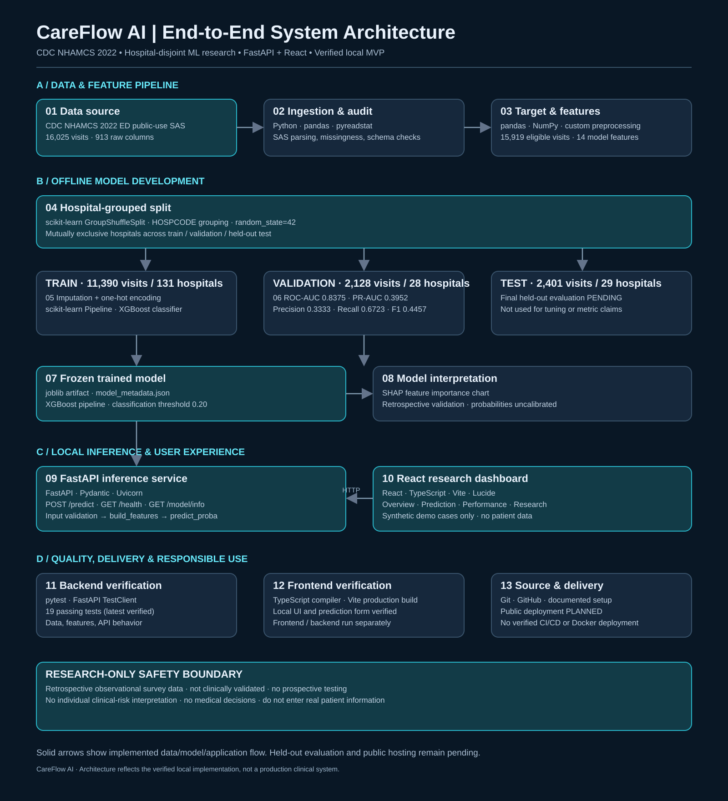
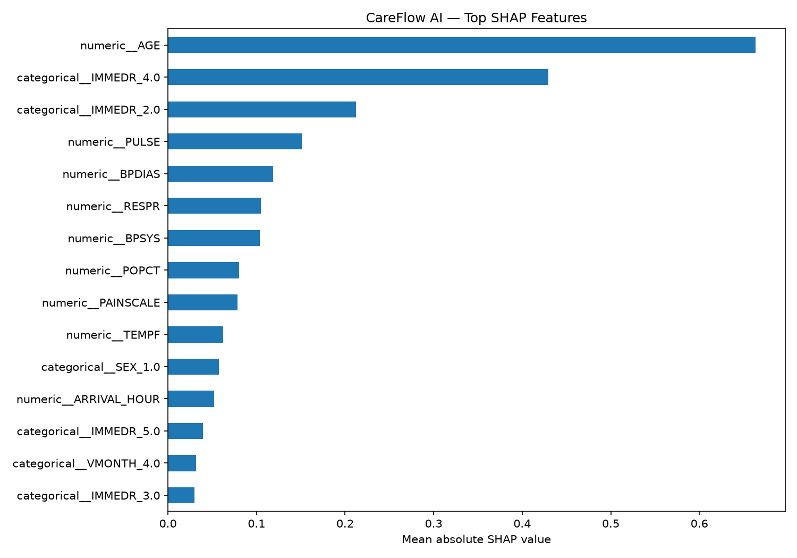

# CareFlow AI
### Emergency Department Admission Prediction & ML Research Platform

An end-to-end machine learning research platform for investigating hospital admission outcomes using emergency department visit data from the **2022 CDC National Hospital Ambulatory Medical Care Survey (NHAMCS)**.

CareFlow AI combines reproducible data preparation, hospital-grouped model evaluation, XGBoost classification, SHAP explainability, a FastAPI inference service, and an interactive React dashboard.

**Project status:** Functional local research prototype. Public deployment and final held-out test evaluation are pending.

**Research disclaimer:** This is an educational and retrospective research project. It is not clinically validated and must not be used to guide patient admission, discharge, treatment, or other clinical decisions.

---

## 1. Project Overview

### Problem Statement

Emergency departments face uncertainty in patient disposition and hospital admission outcomes. Machine learning can help researchers explore relationships between available visit information and observed admissions.

CareFlow AI investigates the following question:

**Can demographic, arrival, triage, and recorded vital-sign information help predict whether an emergency department visit results in hospital admission?**

The objective is to build a reproducible research system rather than a clinical decision-support product.

### Key Capabilities

- Ingest and validate the CDC NHAMCS 2022 emergency department SAS dataset.
- Define a reproducible binary hospital-admission target.
- Prepare demographic, arrival, triage, and vital-sign features.
- Split data by hospital to reduce cross-hospital leakage.
- Train and evaluate an XGBoost classification pipeline.
- Examine model behavior through SHAP feature attribution.
- Serve predictions using FastAPI.
- Explore synthetic demonstration cases through a React and TypeScript dashboard.
- Document research assumptions, validation results, and limitations.

---

## 2. System Architecture



The diagram documents the implemented **offline ML workflow** (data ingestion, feature engineering, hospital-disjoint splitting, training, validation, and SHAP analysis) and the **local inference workflow** (saved model, FastAPI service, and React dashboard). The held-out test evaluation and public deployment are explicitly marked as pending.

A separate held-out test partition is preserved for final evaluation.

### Architecture Principles

**Reproducibility:** Data preparation, feature construction, and model training are implemented in reusable Python modules.

**Leakage reduction:** Hospital identifiers are used to construct mutually exclusive training, validation, and test partitions.

**Separation of concerns:** Model training, inference, and frontend presentation are implemented as separate components.

**Research transparency:** Validation metrics, classification thresholds, model limitations, and explainability results are documented.

---

## 3. Technology Stack

| Layer | Technologies |
|---|---|
| Programming | Python, TypeScript |
| Data processing | pandas, NumPy, pyreadstat |
| Machine learning | scikit-learn, XGBoost |
| Model explainability | SHAP |
| Model serialization | joblib |
| Backend API | FastAPI, Pydantic, Uvicorn |
| Frontend | React, Vite, TypeScript |
| Interface icons | Lucide React |
| Testing | pytest, FastAPI TestClient |
| Version control | Git, GitHub |

---

## 4. Dataset

**Source:** CDC National Hospital Ambulatory Medical Care Survey (NHAMCS), 2022 Emergency Department public-use data.

| Dataset characteristic | Value |
|---|---:|
| Original ED visit records | 16,025 |
| Eligible records | 15,919 |
| Hospital admissions | 2,121 |
| Sampled hospitals | 188 |
| Training visits | 11,390 |
| Validation visits | 2,128 |
| Held-out test visits | 2,401 |

The eligibility process excludes records with the designated no-disposition flag.

### Input Features

The current model uses 14 engineered input features covering:

- Patient age and sex
- Residence category
- Triage immediacy
- Temperature
- Pulse
- Respiratory rate
- Systolic and diastolic blood pressure
- Oxygen saturation
- Pain scale
- Visit month and day
- Arrival hour

The original SAS dataset is not included in the repository. Obtain the public-use dataset from the CDC and place it at:

`data/raw/ed2022_sas.sas7bdat`

Dataset documentation and variable coding should be consulted before interpreting the raw values.

---

## 5. Machine Learning Methodology

### Target Definition

The binary classification target represents whether an eligible emergency department visit resulted in a recorded hospital admission.

The target is derived from the NHAMCS hospital-admission disposition variable.

See `docs/target-definition.md` for the project's target construction notes.

### Hospital-Grouped Splitting

CareFlow AI uses scikit-learn's `GroupShuffleSplit` with hospital identifiers as groups.

The split ensures that a hospital appearing in one partition does not appear in another partition.

This reduces one source of evaluation leakage, although it does not eliminate all possible biases or guarantee performance at unseen hospitals.

### Model Pipeline

The classification pipeline contains:

1. Numeric feature imputation using median values.
2. Categorical feature imputation using the most frequent value.
3. One-hot encoding for categorical variables.
4. An XGBoost binary classifier.

The current model uses 300 boosting estimators, a maximum tree depth of 3, and a learning rate of 0.05.

### Classification Threshold

The application uses a classification threshold of **0.20**.

Predictions at or above this threshold are assigned to the admission-positive class.

This is a research classification setting, not a clinically validated threshold.

---

## 6. Model Evaluation

### Validation Results

The following metrics were obtained on the hospital-disjoint validation partition.

| Metric | Validation result |
|---|---:|
| ROC-AUC | 0.8375 |
| PR-AUC / Average Precision | 0.3952 |
| Precision at threshold 0.20 | 0.3333 |
| Recall at threshold 0.20 | 0.6723 |
| F1-score at threshold 0.20 | 0.4457 |

These values describe retrospective validation performance.

**Held-out test evaluation:** Pending. The test partition has not yet been used for final performance reporting.

### Model Explainability

SHAP analysis is included to examine feature attribution in the trained model.



SHAP feature importance describes the model's behavior. It does not establish causal relationships or clinical relevance.

### Probability Calibration

Calibration was investigated during development, but the saved research model retains its original, uncalibrated probability outputs.

The reported prediction probabilities must not be interpreted as validated individual patient risk estimates.

---

## 7. Interactive Research Dashboard

The frontend contains four main sections.

**Research Overview:** Dataset statistics, model snapshot, and navigation.

**Admission Prediction:** Synthetic demonstration inputs submitted to the saved XGBoost model through FastAPI.

**Model Performance:** Validation metrics, classification threshold, and SHAP feature importance.

**Research & Limitations:** Dataset information, architecture, reproducibility, and responsible-use boundaries.

The application is designed for research demonstrations. Do not enter real patient information.

---

## 8. Project Structure

```text
careflow-ai/
├── artifacts/
│   └── model_metadata.json
├── data/
│   └── raw/
├── docs/
│   ├── architecture/
│   │   └── careflow-system-architecture.svg
│   └── target-definition.md
├── frontend/
│   ├── public/
│   │   └── figures/
│   └── src/
│       ├── pages/
│       ├── services/
│       ├── types/
│       ├── App.tsx
│       └── App.css
├── reports/
│   └── figures/
├── src/
│   └── careflow/
│       ├── api.py
│       ├── features.py
│       ├── ingestion.py
│       ├── save_model.py
│       ├── split.py
│       ├── target.py
│       ├── train_xgboost.py
│       └── explain.py
├── tests/
├── pyproject.toml
└── README.md
```

The saved model artifact is generated locally and is not included in version control in the current workflow.

---

## 9. Local Setup

### Prerequisites

- Python 3.12
- Node.js and npm
- Git
- CDC NHAMCS 2022 ED SAS public-use dataset

### Clone the Repository

```bash
git clone https://github.com/SaiSakethN/careflow-ai.git
cd careflow-ai
```

### Create a Python Environment

Windows PowerShell:

```powershell
py -3.12 -m venv .venv
.\.venv\Scripts\Activate.ps1
python -m pip install -e ".[dev]"
```

### Prepare the Dataset

Place the downloaded SAS file at:

```text
data/raw/ed2022_sas.sas7bdat
```

### Generate the Saved Model

```powershell
python -m careflow.save_model
```

This recreates the model artifact using the implemented training pipeline. It requires the dataset and project dependencies.

### Start the FastAPI Backend

```powershell
python -m uvicorn careflow.api:app --host 127.0.0.1 --port 8765
```

API documentation:

`http://127.0.0.1:8765/docs`

### Start the React Frontend

In a separate terminal:

```powershell
cd frontend
npm install
npm run dev
```

Open the local address displayed by Vite, typically:

`http://localhost:5173`

The development server proxies `/api` requests to the local FastAPI backend.

---

## 10. Testing

Run the backend test suite from the project root:

```powershell
python -m pytest -q
```

Latest verified result:

**19 passed, 1 deprecation warning.**

Build the frontend:

```powershell
cd frontend
npm run build
```

The production build has been verified successfully.

---

## 11. Limitations and Responsible Use

CareFlow AI has several important limitations:

- The dataset is retrospective and represents sampled visits from 2022.
- The model has not been externally or prospectively validated.
- Hospital-grouped validation does not guarantee generalization to all hospitals.
- Model outputs are not calibrated for individual clinical risk.
- Performance across demographic groups and other subpopulations has not been comprehensively audited.
- The held-out test evaluation remains pending.
- The application is not designed to store or process real patient information.

**CareFlow AI must not be used for clinical decision-making.**

---

## 12. Project Status and Future Work

### Implemented

- Data ingestion and validation
- Admission target construction
- Feature preprocessing
- Hospital-grouped dataset splitting
- XGBoost model training
- Validation evaluation
- SHAP analysis
- FastAPI inference
- React dashboard
- Automated backend tests

### Planned

- Final held-out test evaluation
- Public frontend and backend deployment
- Additional documentation and deployment verification
- Further calibration and subgroup research, if pursued in a separate experimental version

---

## Author

**Sai Saketh Nagavalli**

AI/ML Engineering · Data Science · Data Engineering

[GitHub](https://github.com/SaiSakethN) | [Portfolio](https://saisakethnagavalli.vercel.app/)

---

*CareFlow AI is an independent educational and machine-learning research project, not a medical device or clinical decision-support system.*